# Korea30 — 한국 첫 30일 퀘스트

한국에 막 온 외국인 근로자·유학생에게 "오늘 할 일" 하나와 그 일에 필요한 한국어·서류·급여 확인을 모국어로 건네는 모바일 웹앱이다. 서버도 계정도 없이 휴대폰 브라우저 안에서만 돌아가고, 홈 화면에 추가하면 인터넷이 없어도 열린다.

**왜 범용 LLM 앱과 다른가.** 채팅 앱에 물으면 그때그때 답 한 번으로 끝난다. Korea30 은 **기록이 쌓인다** — 매일의 출퇴근 시간이 기기에 남아 월급날 명세서와 바로 비교된다. **먼저 알려 준다** — 묻지 않아도 외국인등록·체류지 신고·체류 만료 기한이 다가오면 화면 위 배너와 휴대폰 캘린더 알림으로 알린다. **제출할 수 있는 결과물이 나온다** — 근무 기록·계산표·진정서 초안을 묶은 PDF, 여권에서 읽은 값으로 채운 외국인등록 신청서 PDF 를 손에 쥔다. 그리고 이 모든 것이 **기기 안에서** 돈다 — 근무 시간도, 여권 사진도 서버로 가지 않는다.

## 화면

미니멀한 모바일 앱 화면이다. 색은 오방색에서 가져와 종이 바탕·먹·청(주색)·황(오늘)만 쓰고 빨강은 긴급에만 쓴다. 아이콘은 직접 그린 선 아이콘, 글꼴은 시스템 폰트다. 긴 설명은 작은 `?` 버튼 뒤에, 안내 문장의 한국어 원문은 `가` 버튼 뒤에 접어 두어 화면 글자를 줄였다. 처음 언어를 고르면 소개 페이지가 한 번 나온다.

| 소개 1 | 소개 2 |
|---|---|
| 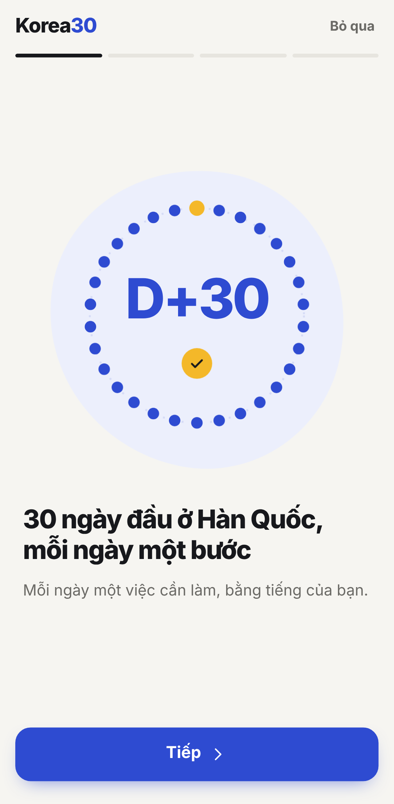 | 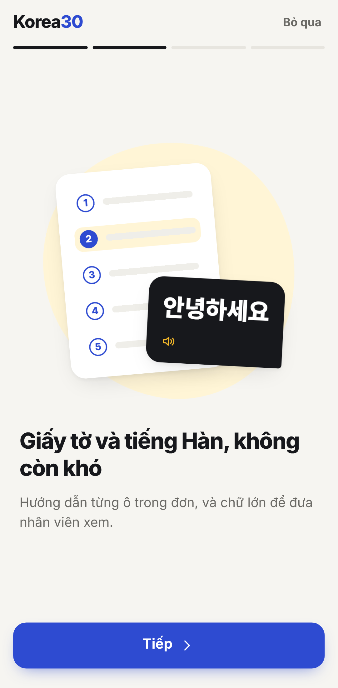 |
| 언어를 고른 직후 4장으로 앱을 소개한다. 30일 고리가 차오르는 등 장마다 그림이 움직인다 | 건너뛰기를 누르거나 마지막 장의 시작하기를 누르면 원래 열려던 화면으로 간다 |

| 언어 선택 | 오늘의 퀘스트 (베트남어) | 서류 칸별 안내 | 급여 검산 |
|---|---|---|---|
| 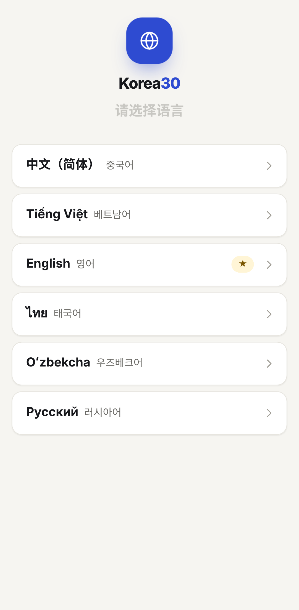 | 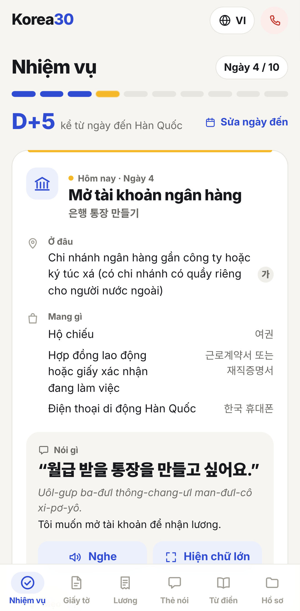 | 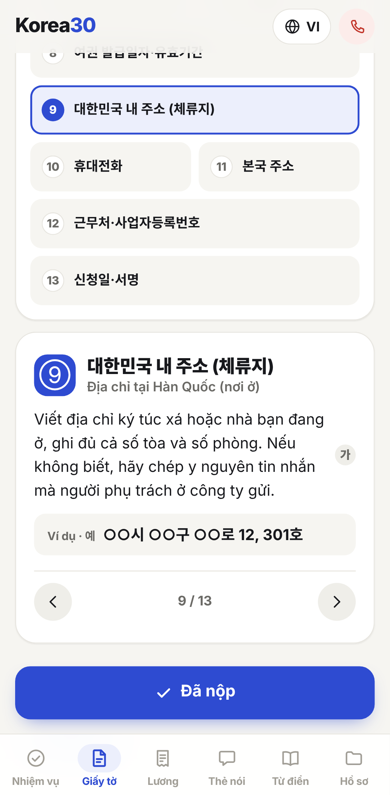 | 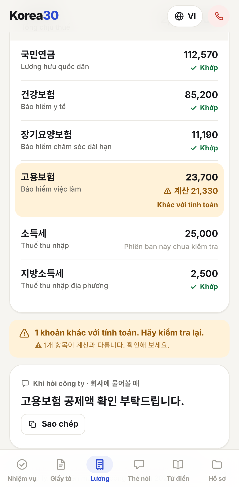 |
| 첫 실행에 6개 언어 중 하나를 고른다 | 도착일 기준 D+N, 어디서·무엇을 들고·뭐라고 말할지 | 고른 칸을 강조하고 모국어로 작성법 안내 | 샘플 B: 고용보험 공제액이 계산과 달라 노란색 표시 |

| 창구 카드 (큰 글씨) | 용어 사전 검색 | 도움 연락처 (영어) |
|---|---|---|
| 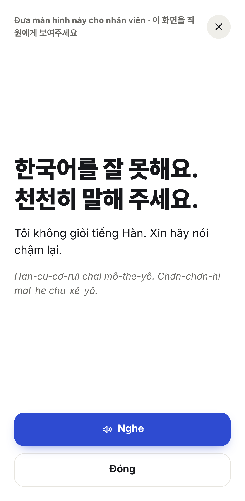 | 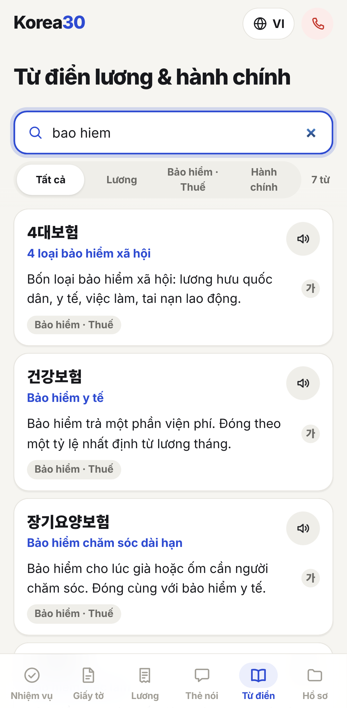 | 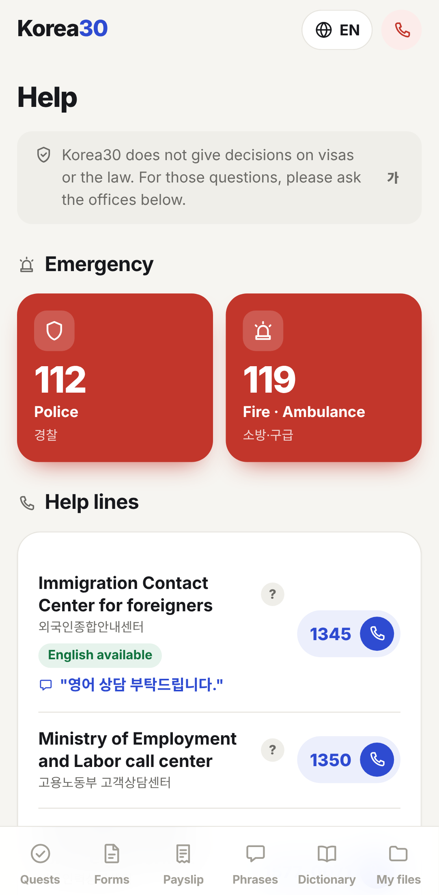 |
| 직원에게 화면을 그대로 보여준다 | 성조 없이 `bao hiem` 으로 찾아도 된다 | 긴급·상담 번호를 바로 건다 |

| 퀘스트 (중국어) | 급여 (러시아어) | 창구 카드 목록 (태국어) |
|---|---|---|
| 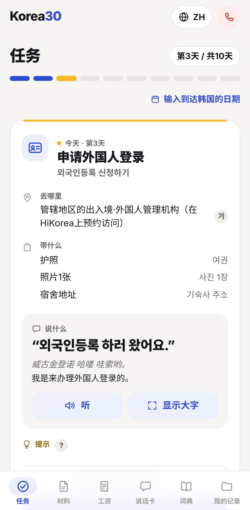 | 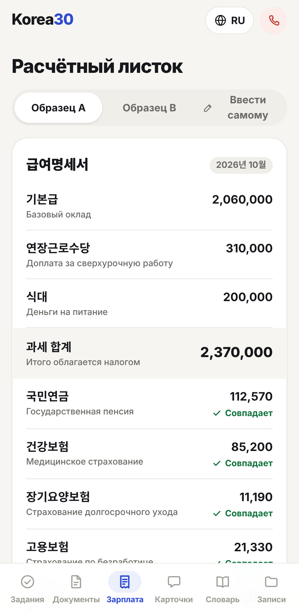 | 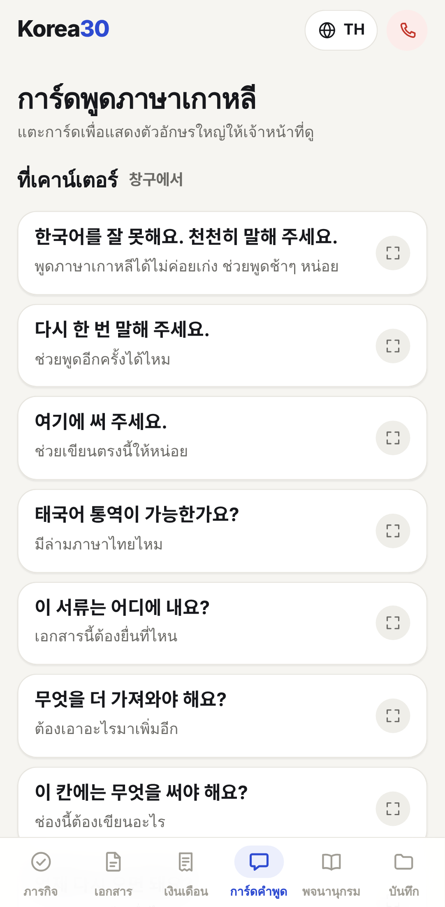 |
| 한국어 발음을 한자 음차로 적는다 | 키릴 문자 화면, 같은 검산 규칙 | 통역 요청 문장도 언어마다 바뀐다 |

내 기록 (`#/tools`) — 근무 기록, 체류 기한, 여권 → 신청서:

| 내 기록 허브 | 근무 기록 | 명세서와 비교 |
|---|---|---|
| 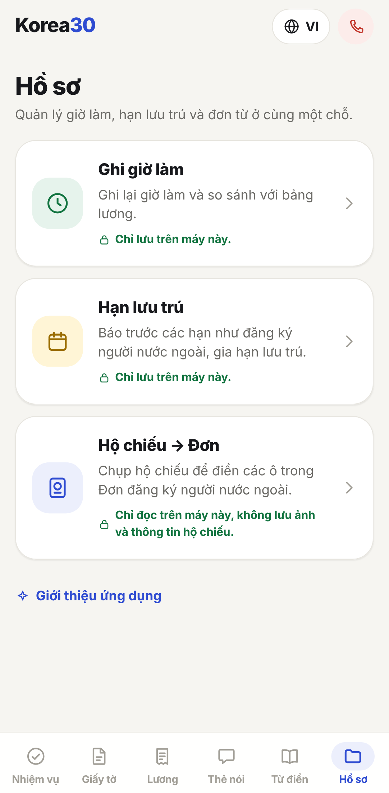 | 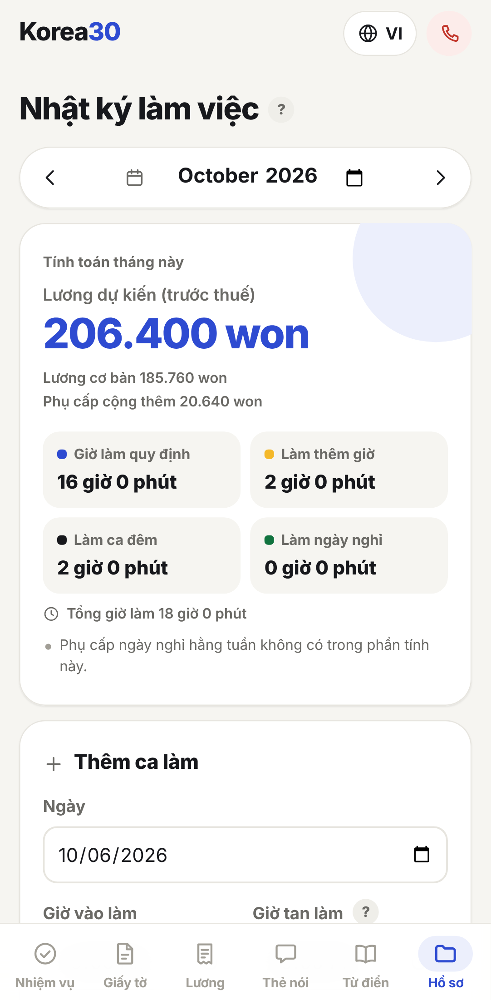 | 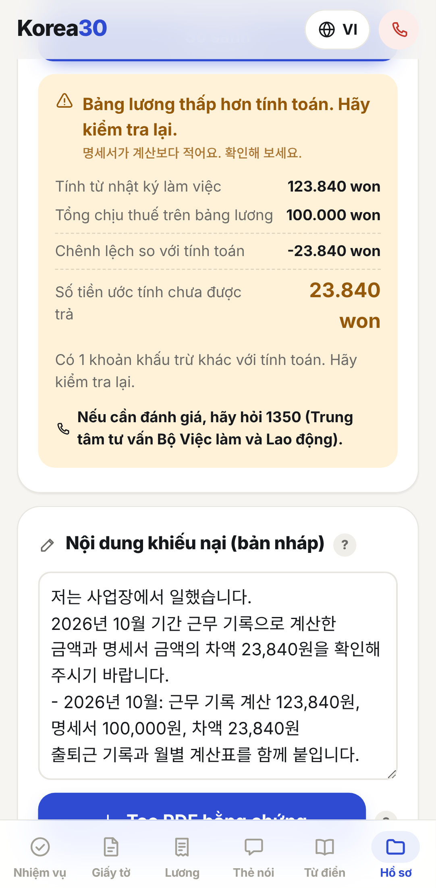 |
| 하단 6번째 탭 하나에 세 기능을 모았다 | 출퇴근을 적으면 이번 달 정규·연장·야간·휴일 시간과 예상 임금을 계산 | 명세서 금액을 넣으면 "계산과의 차액"만 보여 주고, 진정서 초안·증거 PDF 로 이어진다 |

| 체류 기한 | 모든 화면 위 기한 배너 | 여권 → 신청서 |
|---|---|---|
| 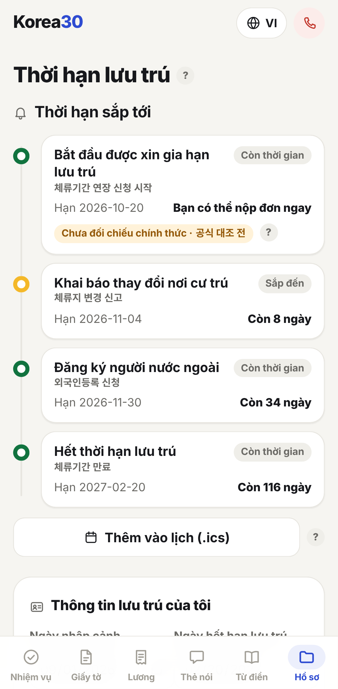 | 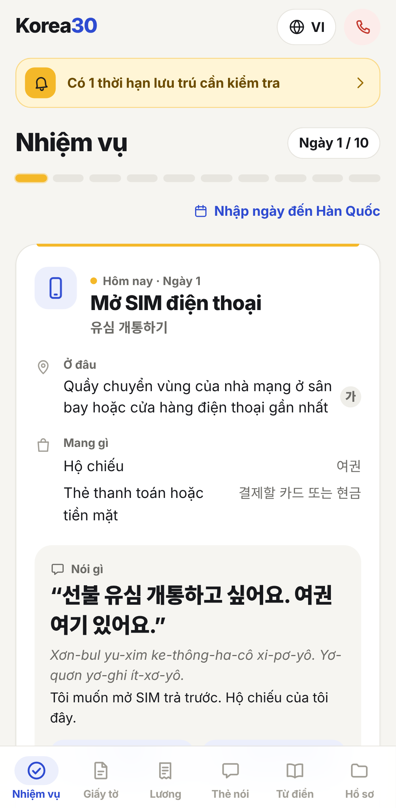 | 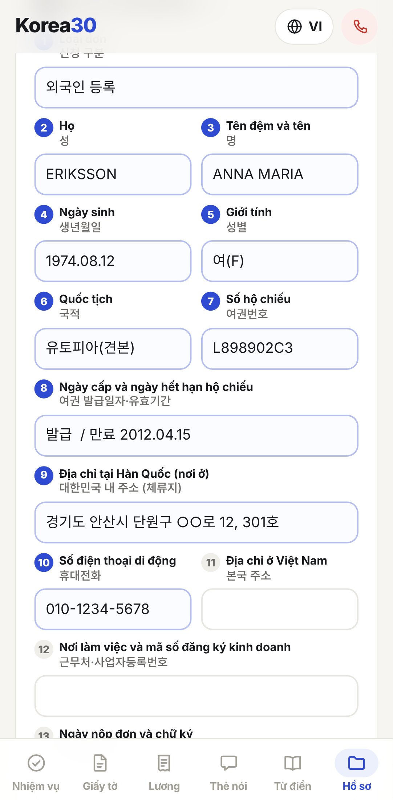 |
| 입국일·비자·만료일로 다가오는 기한을 줄 세우고 캘린더 파일(.ics)로 내보낸다 | 7일 이내·지난 기한이 있으면 앱을 열 때마다 알린다 | 여권 아래 두 줄(MRZ)을 기기 안에서 읽어 신청서 13칸을 채운다 |

| 근무 사진 목록 | 사진 보기·만료일 |
|---|---|
| 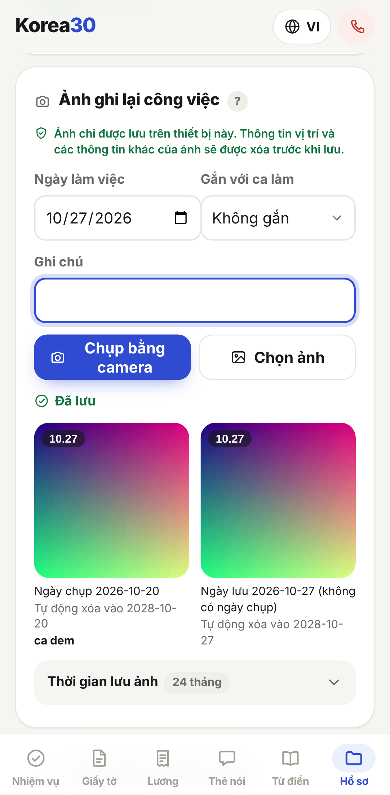 | 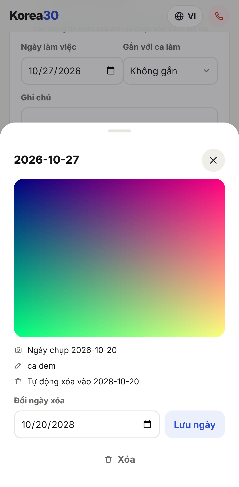 |
| 근무 기록 화면 안에서 찍거나 사진첩에서 고른다. 위치정보를 지우고 촬영일과 보관 기한을 보여 준다 | 크게 보고 근무와 연결하거나 만료일을 늦춘다. 만료일은 오늘 뒤 날짜만 받는다 |

스크린샷은 Playwright Chromium 의 Pixel 7 뷰포트(412×915)로 찍었다.

## 왜 만들었나

낯선 나라의 첫 한 달은 정보 부족이 아니라 **순서와 언어**의 문제다. 할 일을 순서대로 주고, 서류를 모국어로 풀어주면 혼자 해낼 수 있다.

- 외국인등록, 통장, 휴대폰, 보험을 어떤 순서로 해야 하는지 모른다.
- 행정 서류와 급여명세서가 한국어 전문 용어로만 온다.
- 한국어를 배우고 싶어도 교재 문장은 은행 창구나 주민센터에서 바로 쓰기 어렵다.

## 주요 기능

| 화면 | 경로 | 하는 일 |
|---|---|---|
| 퀘스트 | `#/` | 30일치 "오늘 할 일"(유심 → 교통카드 → 외국인등록 → 통장 → … → 첫 급여명세서 → 등록증 수령 → 체류지 변경 신고 → 긴급전화·모국어 상담 → … → 일하다 다쳤을 때 → 출입국 방문 예약 → … → 첫 한 달 기록 백업). 완료하면 다음 날이 열린다. 도착일을 넣으면 D+N 표시, 체류 기한의 입국일이 비어 있으면 같은 날짜로 채운다. 창구에서 할 말을 듣기·크게 보기. 진행·도착일을 기기에 저장하지 못하면 "앱을 닫으면 사라져요"라고 알린다 |
| 서류 | `#/form` | 외국인등록 신청서를 본뜬 가상 샘플 양식 13칸. 칸을 누르면 작성법과 예시를 보여준다. 판단이 필요한 칸은 "담당 공무원에게 물어보세요"로 안내 |
| 급여 | `#/payslip` | 샘플 명세서 2건 또는 직접 입력으로 국민연금·건강보험·장기요양·고용보험·지방소득세 공제를 2026 요율로 다시 계산. 10원 넘게 다르면 "계산과 다릅니다"만 표시. 입력값은 저장하지 않는다 |
| 카드 | `#/cards` | 창구·일상 문장 카드. 한국어·번역문 듣기(미리 녹음한 음성, 안 되면 기기 음성)와 큰 글씨 보기 |
| 사전 | `#/glossary` | 급여·행정 용어 40개. 선택 언어로도, 성조·악센트 없이도 검색 |
| 도움 | `#/help` (헤더 ☎) | 긴급·상담 연락처 9개, 누르면 전화 연결 |
| 내 기록 | `#/tools` | 하단 6번째 탭. 아래 세 기능으로 들어가는 허브 |
| 근무 기록·증거 PDF | `#/work` | 출퇴근·휴게·휴일 근무를 기록하면 월별 정규·연장·야간·휴일 시간과 예상 임금을 법정 가산율·2026 최저임금으로 계산. 명세서 금액을 넣으면 계산과의 차액을 보여 준다(1,000원 이내는 같음). 출퇴근표·월별 계산·법정 근거·명세서 비교·진정서 초안을 묶은 PDF 를 만든다 |
| 사진 기록 | `#/work` | 근무 기록 화면에서 출퇴근 기록기 화면·근무표처럼 근무를 보여 주는 사진을 찍거나 사진첩에서 골라 근무와 함께 남긴다. 저장 전에 위치정보 등 EXIF 를 지우고 촬영일만 남긴다. 보관 기간은 앱 설정(기본 24개월, 1~120개월, 법정 기간 아님)이고 만료 30일 전부터 안내한다. 만료된 사진은 묻지 않고 지우지 않는다. 앱을 열면 어느 화면에서든 "지우기" 또는 "1년 더 보관"을 묻고 임금채권 시효(3년)를 함께 알린다. 만료 안 된 사진은 증거 PDF 에 넣을 수 있고, 손상된 사진 때문에 PDF 를 못 만들면 "사진 없이 다시 만들기"를 고를 수 있다 |
| 체류 기한 | `#/deadline` | 입국일·비자·체류 만료일·이사한 날·계약 종료일로 외국인등록(90일)·체류지 변경 신고(15일)·연장 신청·사업장 변경 신청 기한을 타임라인으로 보여 주고 지연 시 벌금 상한을 함께 적는다. `.ics` 로 내보내면 휴대폰 캘린더가 7일 전·1일 전에 모국어로 알린다. 임박한 기한은 모든 화면 위 배너로. 입력하는 동안 저장 전 타임라인을 "미리보기"로 보여 주고, 입국일을 저장하면 비어 있는 퀘스트 도착일을 같은 날짜로 채운다 |
| 기록 백업 | `#/tools` | 로그인 없이 근무 기록·사진·체류 정보·퀘스트 진행을 JSON 파일 하나로 내보내고(휴대폰 공유 시트 또는 내려받기), 그 파일로 되살린다. 되살리기 전에 파일과 지금 기기의 기록 수를 보여 주고 확인을 받는다. 기록이 바뀌었는데 2일 넘게 백업하지 않았으면 화면 위에서 백업을 권한다 |
| 홈 화면 설치·오프라인 | (모든 화면) | 홈 화면에 추가하면 앱처럼 열리고, 한 번 연 뒤에는 인터넷 없이도 퀘스트·서류·급여·카드·사전·녹음 듣기·PDF 만들기가 된다. 퀘스트 화면 위에서 설치를 권한다(안드로이드는 설치 버튼, 아이폰은 Safari 공유 → "홈 화면에 추가" 그림). 닫으면 다시 묻지 않는다. 새 버전이 나오면 "새로고침" 안내를 띄운다 |
| 여권 → 신청서 | `#/passport` | 여권 사진의 MRZ 두 줄을 기기 안에서 OCR(또는 직접 입력)·체크섬 검사해 외국인등록 신청서 13칸을 채우고 PDF 로 내려받는다. 여권 사진·값은 저장하지 않는다 |
| 개인정보처리방침·이용 안내 | `#/privacy`, `#/terms` | 모으지 않는 것·기기에 저장되는 것·사진과 여권·백업 파일·호스팅 접속 기록을 적은 개인정보처리방침과, 법률·비자 판단이 아니라는 이용 안내. 내 기록 화면 아래 링크 2개와 도움 화면 맨 위 안내의 링크로 들어간다. 두 화면 모두 문의 연락처를 보여 주고, 연락처가 설정되지 않았으면 "준비 중"으로 보인다 |

모든 화면은 선택한 언어와 한국어 원문을 함께 보여준다. 한국어 발음은 사용자의 문자로 적는다(중국어 한자 음차, 태국 문자, 키릴, 우즈벡 라틴, 영어 로마자, 베트남어 표기).

## 지원 언어와 선정 근거

中文(简体) · Tiếng Việt · English · ไทย · Oʻzbekcha · Русский — 첫 실행에서 고르고 헤더 🌐 로 언제든 바꾼다. 선택은 기기에만 저장한다.

법무부 출입국·외국인정책본부 2025년 말 체류외국인 국적별 현황 기준 상위 국적을 따랐다.

| 국적 | 체류 인원 | 언어 |
|---|---:|---|
| 중국 | 980,670 | 中文 |
| 베트남 | 337,183 | Tiếng Việt |
| 미국 | 180,230 | English |
| 태국 | 169,848 | ไทย |
| 우즈베키스탄 | 102,804 | Oʻzbekcha |
| 필리핀 | 74,125 | English 로 포괄 |

러시아어는 CIS 지역 공용어(고려인 포함)라서 추가했다. 출처: https://www.moj.go.kr/moj/2412/subview.do

## 기술 스택과 구조

- Vite + React + TypeScript 정적 SPA. 해시 라우팅, 라우터·i18n 라이브러리 없음.
- PWA: vite-plugin-pwa(MIT, 개발 의존성)가 빌드할 때 서비스 워커(`sw.js`)와 `manifest.webmanifest` 를 만든다. 앱 코드·녹음 MP3 337개·PDF 한글 폰트를 첫 방문 때 미리 캐시하고(357개 파일), OCR 엔진·언어 데이터는 처음 쓸 때 캐시한다. 브라우저 번들에 들어가는 것은 workbox-window 뿐이다.
- **기기 안에서만 처리**: 서버·API 키·외부 요청·웹폰트가 없다. 언어·퀘스트 진행·도착일·소개 페이지를 봤는지·마지막 백업 시각·설치 안내를 닫았는지는 localStorage, 근무 기록·근무 사진·체류 정보는 IndexedDB 에 저장한다. 급여 입력값과 여권 사진·값은 메모리에만 둔다.
- 근무 기록·체류 기한·여권 기능에는 date-fns · idb · mrz · tesseract.js · pdfmake · ics 를, 근무 사진에는 compressorjs(재인코딩·EXIF 제거) · exifr(촬영일)를 쓴다. OCR 엔진·언어 데이터(`public/tessdata/`)와 PDF 한글 폰트(`public/fonts/`, Noto Sans KR 서브셋, OFL)는 앱과 같은 곳에서 내려받고, 필요할 때만 불러온다. 라이선스와 고른 이유는 [docs/decisions.md](docs/decisions.md).
- 법정 수치(최저임금, 가산율, 등록·신고 기한, 벌금 상한 등 18개)는 `src/legal/data/` 한 곳에 법령·조항·URL·공식 대조 상태와 함께 둔다. 대조 전 항목이 계산에 쓰이면 화면에 "공식 대조 전" 배지를 단다.
- 급여 검산은 LLM 이 아니라 규칙 기반이다. 요율은 `src/payroll/rates2026.ts` 한 곳, 계산은 원 단위·ppm 정수 연산.
- **듣기는 미리 녹음한 음성**: 앱에 고정된 문장(사전 용어·카드·퀘스트에서 할 말)을 개발할 때 Supertonic 3 모델(목소리 F5, `total_steps` 8)로 녹음해 `public/voice/<lang>/<key>.mp3` 로 함께 배포한다. 한국어(`ko`)와 번역문 `vi`·`en`·`ru` 337개(ko 91 · vi 82 · en 82 · ru 82), 합계 약 3.8 MB(3,756,524 B), 길이 1.25~7.87초, MP3 모노 24 kHz 32 kbps(iOS Safari·Android·Playwright Chromium 공통 재생). 파일 이름은 언어 + 문장의 FNV-1a 해시라 문장을 고치면 새 녹음이 필요하고, 빠지면 `npm test` 가 실패한다. 녹음을 못 틀면(파일 없음·손상·4초 초과) 기기 음성 합성으로 읽고, 둘 다 안 되면 버튼을 숨긴다. Supertonic 3 이 지원하지 않는 zh·th·uz 번역문은 녹음 없이 기기에 그 언어 음성이 있을 때만 읽는다. 앱 안에서 모델을 돌리지 않고 외부 요청도 없다.
- 녹음 음성 출처·라이선스: Supertonic(https://github.com/supertone-inc/supertonic , 모델 https://huggingface.co/Supertone/supertonic-3) — 코드 MIT, 모델 가중치 OpenRAIL-M. 앱에는 생성된 음성만 들어간다(`public/voice/NOTICE.txt`).

```
src/
  quest/      30일 퀘스트 데이터(1~10일 quests.ts, 11~20일 days11to20.ts, 21~30일 days21to30.ts, 문구 검사기 contentRules.ts), 진행 저장, 도착일·D+N
  forms/      외국인등록 신청서 샘플 13칸과 안내
  payroll/    2026 요율표, 공제 검산, 수기 입력 파싱
  cards/      창구 문장 카드
  glossary/   용어 사전 40개
  help/       도움 연락처
  i18n/       6개 언어 팩, 언어 저장·감지, 성조 무시 검색
  speech/     녹음 재생·기기 음성 폴백, 녹음 대상 목록·파일 키
  components/ 하단 탭, 언어 선택, 소개 페이지, 큰 글씨 카드, 아이콘·? 도움말 등 공용 UI
  ui/         새 UI 공용 문자열(UI_PACKS)과 소개 페이지 저장
  legal/      법정 수치 데이터·출처·대조 상태 배지
  storage/    IndexedDB 저장소(근무 기록·근무 사진·체류 정보)
  pdf/        PDF 렌더(지연 로딩)·다운로드
  worklog/    근무 시간 분류·임금 계산·명세서 비교·증거 PDF·진정서 초안·근무 사진(photos/)
  deadline/   체류 기한 규칙·타임라인·ICS·배너
  passport/   MRZ 파싱·OCR·신청서 칸 매핑·신청서 PDF
  tools/      내 기록 허브 문자열
  backup/     백업 파일 형식·내보내기·되살리기·백업 알림
  pwa/        새 버전 안내·홈 화면 추가 권유
  screens/    화면 10개
scripts/voice/  녹음 대상 manifest 내보내기, Supertonic 녹음 스크립트(record.py)
public/voice/   녹음 MP3 와 NOTICE.txt
```

## 실행 방법

Node.js(npm)가 필요하다.

```sh
npm install && npx playwright install chromium   # 의존성과 E2E용 Chromium
npm run dev                                      # http://localhost:5173
```

휴대폰에서 보려면 `npx vite --host --port 5173` 로 띄우고, 같은 Wi-Fi 의 휴대폰 브라우저에서 터미널에 표시된 Network 주소로 접속한다.

서비스 워커(오프라인·홈 화면 설치·새 버전 안내)는 빌드 결과에서만 돈다. 개발 서버에서는 꺼져 있다.

```sh
npm run build && npx vite preview --host localhost --port 4173   # http://localhost:4173
```

## Cloudflare Pages 배포

빌드 결과 `dist/` 는 정적 파일뿐이라 Cloudflare Pages 에 그대로 올린다. 서버 코드는 없다.

Cloudflare 대시보드의 Workers & Pages → Create 는 처음에 Workers 설정 화면을 보여 준다. Pages 로 가려면 화면 아래 "Looking to deploy Pages? Get started" → Import an existing Git repository 를 고른다.
GitHub 앱의 저장소 접근이 "Only select repositories" 이면 GitHub Settings → Applications → Cloudflare Workers and Pages → Configure 에서 이 저장소를 추가해야 목록에 보인다.

**(1) Git 저장소 연결 (권장)**

| 항목 | 값 |
|---|---|
| Framework preset | 없음(None) 또는 Vite |
| Build command | `npm run build && node scripts/deploy/check-size.mjs dist` |
| Build output directory | `dist` |
| 환경 변수 `NODE_VERSION` | 로컬 `node -v` 의 메이저 값 (현재 `24`) |
| 환경 변수 `VITE_CONTACT_EMAIL` (선택) | 문의 이메일 주소. 빌드할 때 앱에 들어간다. 비우면 화면에 "문의 연락처는 준비 중이에요"가 보인다. 저장소·`.env` 파일에는 넣지 않는다 |

`VITE_CONTACT_EMAIL` 은 `src/about/site.ts` 한 곳에서만 읽는다. 앞뒤 공백은 지우고 이메일 형식이 아니면 없는 것으로 본다. 값을 바꾸면 다시 빌드(재배포)해야 반영된다.

**(2) 직접 업로드 (대안)**

```sh
npm run build && node scripts/deploy/check-size.mjs dist
npx wrangler pages deploy dist --project-name korea30
```

`wrangler` 는 이 저장소 의존성에 없어서 `npx` 가 그때 내려받는다. Cloudflare 계정 로그인이 필요하다.

**(3) 응답 헤더 (`public/_headers`)**

빌드하면 `public/_headers` 가 `dist/_headers` 로 복사되고, Pages 가 이 규칙대로 헤더를 붙인다.

| 경로 | 헤더 | 이유 |
|---|---|---|
| `/*` | `X-Content-Type-Options: nosniff` | 파일 형식 추측 차단 |
| `/*` | `Referrer-Policy: no-referrer` | 다른 곳으로 이동할 때 주소를 넘기지 않음 |
| `/*` | `X-Frame-Options: DENY` | 다른 사이트 안에 끼워 넣기 차단 |
| `/*` | `Cross-Origin-Opener-Policy: same-origin` | 다른 창과 실행 환경 분리 |
| `/*` | `Permissions-Policy: camera=(self), microphone=(), geolocation=()` | 카메라는 여권·근무 사진에만, 마이크·위치는 쓰지 않음 |
| `/*` | `Content-Security-Policy-Report-Only: …` | 아래 (4) |
| `/`, `/index.html`, `/sw.js`, `/manifest.webmanifest` | `Cache-Control: no-cache` | 새 버전을 바로 확인하도록 매번 재검증 |
| `/assets/*` | `Cache-Control: public, max-age=31536000, immutable` | 파일 이름에 해시가 있어 1년 캐시해도 안전 |

`/*` 에는 `Cache-Control` 을 넣지 않는다. Pages 는 겹치는 규칙의 같은 헤더를 쉼표로 합치기 때문이다. `fonts/`·`voice/`·`tessdata/` 처럼 이름에 해시가 없는 파일은 Pages 기본 동작(ETag 재검증)을 따른다. HSTS 는 도메인을 연결할 때 Cloudflare 설정에서 켠다.

**(4) CSP 가 Report-Only 인 이유**

CSP 는 위반을 막지 않고 보고만 하는 `Content-Security-Policy-Report-Only` 로 넣었다. 여권 OCR(WebAssembly·워커)·PDF 만들기·서비스 워커를 실제 휴대폰에서 확인하기 전에 강제로 막으면 기능이 깨질 수 있어서다. 같은 정책을 강제로 적용했을 때 깨지지 않는지는 PWA E2E(`tests/pwa/deploy-headers.spec.ts`)가 문서 응답에 `Content-Security-Policy` 헤더를 붙여 미리 검사한다.
강제로 바꾸려면 `public/_headers` 의 헤더 이름만 `Content-Security-Policy-Report-Only` → `Content-Security-Policy` 로 바꾸고 다시 배포한다. 값은 그대로 둔다.

**(5) 파일 크기 상한**

Pages 는 파일 하나가 25 MiB(26,214,400 B)를 넘으면 올리지 못한다. `scripts/deploy/check-size.mjs` 가 빌드 직후 이를 검사한다.

```sh
node scripts/deploy/check-size.mjs dist                      # 기본 상한 25 MiB
node scripts/deploy/check-size.mjs dist --max-bytes 1000000  # 상한 바꾸기
```

종료 코드: `0` 모두 상한 이하(`SIZE OK …`), `1` 넘는 파일 있음(파일마다 `SIZE FAIL …`), `2` 폴더가 없거나 옵션이 잘못됨(`SIZE ERROR …`). Build command 에 붙여 두면 넘는 파일이 있을 때 배포가 멈춘다.

**(6) SPA 리다이렉트는 필요 없다**

화면 이동이 해시(`#/form`, `#/privacy` …)라 서버는 항상 `/` 만 받는다. 그래서 `_redirects` 파일을 두지 않는다.

## Firebase Hosting 배포

같은 `dist/` 를 Firebase Hosting 에도 올릴 수 있다. 설정은 `firebase.json`(사이트·`public: dist`·SPA rewrite·응답 헤더)과 `.firebaserc`(기본 프로젝트)에 있다. 응답 헤더는 `public/_headers` 와 같은 값을 `firebase.json` 의 `headers` 에 옮겨 두었으므로, 한쪽을 고치면 다른 쪽도 같이 고친다. 정적 파일이 있으면 rewrite 보다 파일이 먼저 나간다.

```sh
npm run build
npx firebase-tools deploy --only hosting --project illy-portfolio
```

## 테스트

```sh
npm test               # 단위 테스트 (Vitest) — 1017개
npx playwright test    # E2E (Playwright, Pixel 7 모바일 뷰포트) — 212개 (PWA E2E 7개는 아래 별도)
npx playwright test -c playwright.pwa.config.ts   # PWA E2E: 빌드 후 vite preview(4173)에서 오프라인 재로드·새 버전 안내
npm run typecheck      # 타입 검사
```

듣기 녹음을 다시 만들 때(문장을 고친 뒤 `npm test` 의 녹음 커버리지 테스트가 실패하면). korea30 루트에서, Supertonic 이 설치된 uv 환경(이 워크스페이스에서는 형제 프로젝트 `../voice-agent` 의 `tts` extra)과 ffmpeg 가 필요하다.

```sh
node scripts/voice/export-manifest.mjs   # 녹음 대상 → scripts/voice/manifest.json
uv run --project ../voice-agent --frozen --extra tts \
  python scripts/voice/record.py --manifest scripts/voice/manifest.json --out public/voice --prune   # 없는 파일만 녹음
uv run --project ../voice-agent --frozen --extra tts \
  python scripts/voice/record.py --manifest scripts/voice/manifest.json --out public/voice --check   # CHECK OK …
npm test
```

E2E 는 퀘스트 진행·저장(11·20·30일 진행·완료·번역 듣기 포함), 서류 칸 이동, 급여 샘플·수기 검산, 카드·사전·도움, 6개 언어 전환과 화면별 가로 넘침, 근무 기록 → 명세서 비교 → 증거 PDF 다운로드, 근무 사진 저장·EXIF 제거·보관 기간·만료 삭제·PDF 사진, 체류 기한 타임라인·배너·ICS 다운로드, 견본 여권 이미지 OCR → 신청서 PDF 다운로드, 6탭 내비게이션, 듣기 녹음 재생(한국어·vi·en·ru)과 녹음 차단·손상 시 기기 음성 폴백·zh 기기 음성·th·uz 버튼 숨김, 첫 언어 선택 뒤 소개 페이지(넘기기·건너뛰기·다시 열기·동작 줄이기), 기기 저장 실패(용량 가득·읽기 실패)·복사 실패·PDF 사진 누락 안내, 근무 기록 삭제 되돌리기, 여권 재판독 때 고친 칸 유지, 앱을 켠 채 자정이 지났을 때 기한 배너 갱신까지 확인한다.

개인정보처리방침·이용 안내 화면(`tests/e2e/about.spec.ts`: 도구·도움 화면 링크로 들어가기, 언어별 제목, 문의 준비 중 표시, 360px 가로 넘침), 빌드 결과 파일 크기 상한(`tests/e2e/deploy-size.spec.ts`), 배포 헤더의 CSP 를 강제로 적용해도 앱·OCR·PDF·서비스 워커가 동작하는지(`tests/pwa/deploy-headers.spec.ts`)도 확인한다.

## 하지 않는 것

- 비자·법률 상담. 앱은 안내만 하고 판단은 전문가에게 넘긴다(도움 화면 맨 위에 명시).
- 구인·구직 매칭.
- "위법", "체불" 같은 판단 문구. 급여와 근무 기록은 계산과의 차액만 알린다. 진정서는 사용자가 고쳐서 직접 내는 초안이다.
- 노동청·출입국 기관 전자 제출이나 진정 접수 대행.
- 로그인·계정, 클라우드 동기화. 기기를 옮길 때는 백업 파일을 쓴다.
- 푸시 알림. 기한 알림은 `.ics` 캘린더와 앱 안 배너로만 한다.
- 앱 스토어 앱. 홈 화면에 추가하는 웹앱(PWA)으로만 배포한다.

## 한계와 다음 할 일

- 번역과 한국어 발음 표기는 **원어민 검수 전**이다. 근무 기록·체류 기한·여권 화면과 진정서 초안 번역도 마찬가지다.
- 2026 공제 요율과 연락처 9개(모국어 지원 여부 포함)는 **공식 자료와 대조 전**이다. 화면에서 1577-0071 에는 "번호 재확인 필요" 배지를 단다.
- 법정 수치 18개 중 17개는 2026-10-27 법령 원문과 대조했다. 체류기간 연장 신청 시작 시점(만료 4개월 전)은 법령 원문에는 없어, 2026-10-29 하이코리아 "체류기간연장허가 절차/방법 > 신청기간" 안내("만료하기 전 4개월부터 만료 당일까지 신청")와 대조해 공식 대조 완료로 바꿨다. 체류 기한 화면의 "공식 대조 전" 배지는 이제 보이지 않는다. 법령이 아니라 안내 페이지 기준이라 안내가 바뀌면 다시 대조해야 한다.
- 서버가 없어서 앱이 닫혀 있으면 알림을 띄울 수 없다. 그래서 기한은 `.ics` 로 휴대폰 캘린더에 넣어 알림을 받는다.
- OCR 은 여권 아래 MRZ 두 줄(영문 대문자·숫자)만 읽는다. 한글 서류·급여명세서 촬영 인식은 하지 않는다.
- 외국인등록 신청서 PDF 는 공식 양식을 본뜬 **자체 양식이고 공식 서식이 아니다**. 출입국·외국인관서의 공식 서식이 우선한다.
- 근무 임금 계산에 주휴수당 금액·소득세 간이세액표·수습 감액·포괄임금은 들어 있지 않다.
- 근무 사진: iPhone 사진첩의 HEIC 는 Safari 에서는 읽지만 크롬 계열 브라우저에서는 열지 못할 수 있다(이때 "이 사진을 열 수 없어요" 안내). 이 경우 JPEG 로 찍거나 바꿔서 올린다.
- 만료 사진은 앱을 열 때 지울지 1년 더 둘지 묻는다. 고를 때까지 앱을 열 때마다 묻고 "나중에" 버튼은 없다.
- 기한 배너가 체류 정보를 읽지 못하면 배너를 띄우지 않는다(체류 기한 화면에서는 읽기 실패를 알린다).
- 듣기 녹음은 **기계 음성**(Supertonic 3)이다. 짧은 용어·숫자·괄호 표기를 어색하게 읽을 수 있고 번역문 발음은 원어민 검수 전이다. zh·th·uz 번역문은 녹음이 없어 기기에 그 언어 음성이 없으면 들을 수 없다. iOS Safari 에서는 녹음 재생이 실패한 뒤의 기기 음성 폴백이 소리 없이 끝날 수 있다(모든 문장에 녹음이 있어 배포 오류 때만 해당).
- 퀘스트 도착일 ↔ 체류 입국일은 한쪽이 비어 있을 때만 채운다. 이미 값이 있으면 덮지 않고, 체류 정보를 저장한 적이 없으면 도착일만으로 체류 정보를 새로 만들지 않는다.
- 오프라인: 첫 방문에 약 8MB(앱·녹음·PDF 폰트)를 미리 받는다. 여권 OCR 은 인터넷이 있을 때 한 번 써야 그 뒤 오프라인에서도 된다.
- 아이폰은 Safari 의 공유 → "홈 화면에 추가"로만 설치된다(설치 버튼 없음). 홈 화면에 추가하지 않고 Safari 에서만 쓰면 7일 동안 열지 않았을 때 Safari 가 저장된 기록을 지울 수 있다.
- 새 버전은 자동으로 바뀌지 않는다. "새로고침" 안내를 눌러야 바뀐다.
- 백업 파일은 **암호화하지 않는다**. 개인정보와 사진이 그대로 들어 있고 사진이 많으면 파일이 크다. 되살리기는 합치지 않고 이 기기의 기록 전체를 파일 내용으로 바꾼다.
- 백업 알림은 근무·사진 추가와 체류 정보·근무 설정·퀘스트 진행·도착일 변경으로 판단한다. 사진 메모나 만료일만 고친 것으로는 뜨지 않는다.
- 퀘스트 11~30일 문구와 발음 표기는 **원어민 검수 전**이다. 기관 절차는 일반 안내 수준이며, 숫자는 대조된 법정 값과 도움 전화 번호만 쓴다.
- 개인정보처리방침·이용 안내 번역(en·vi·zh·th·uz·ru)은 **원어민 검수 전**이다.
- 문의 연락처는 배포 환경 변수 `VITE_CONTACT_EMAIL` 을 설정하기 전까지 "준비 중"으로 보인다.
- CSP 는 **Report-Only** 다. 위반을 막지 않고 보고만 한다. 실기기 확인 뒤 강제로 바꿀지 따로 정한다.

## 결정 기록

